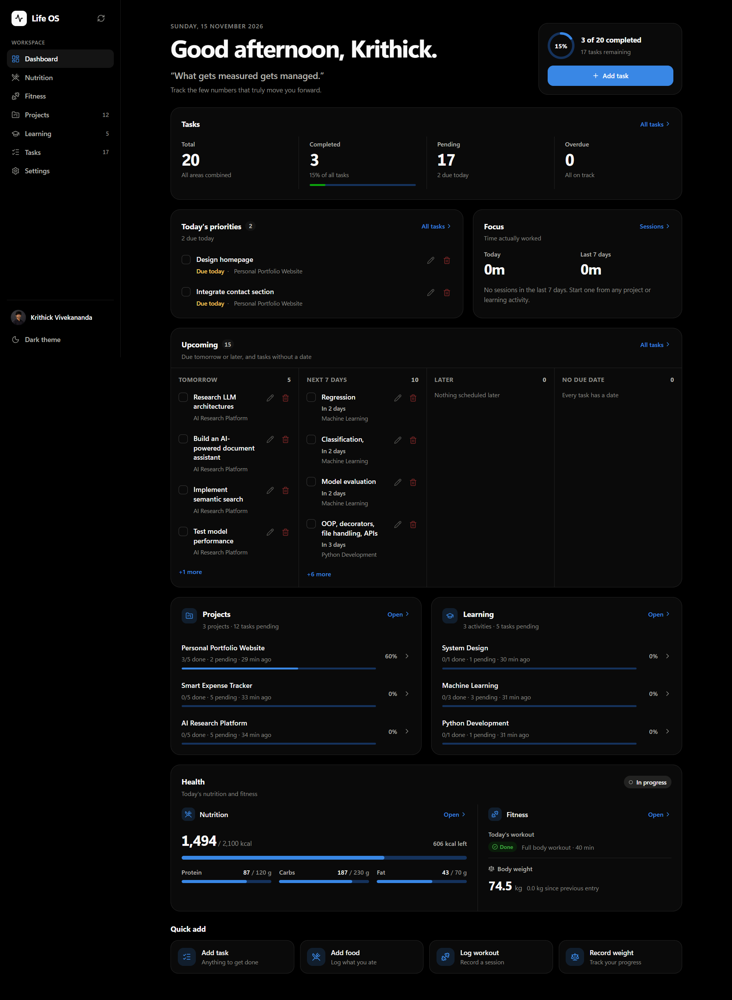
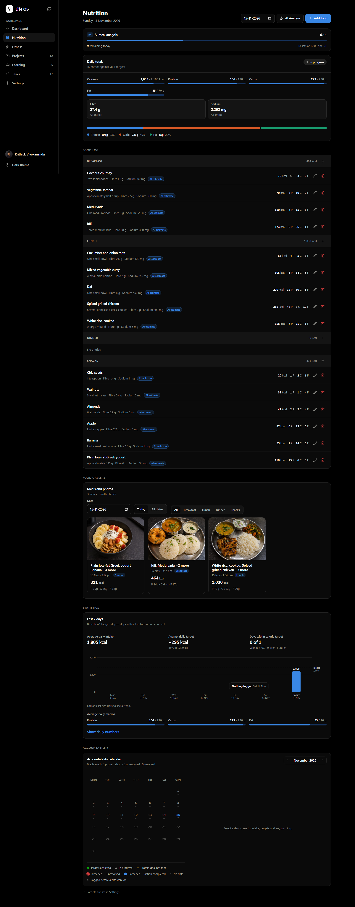
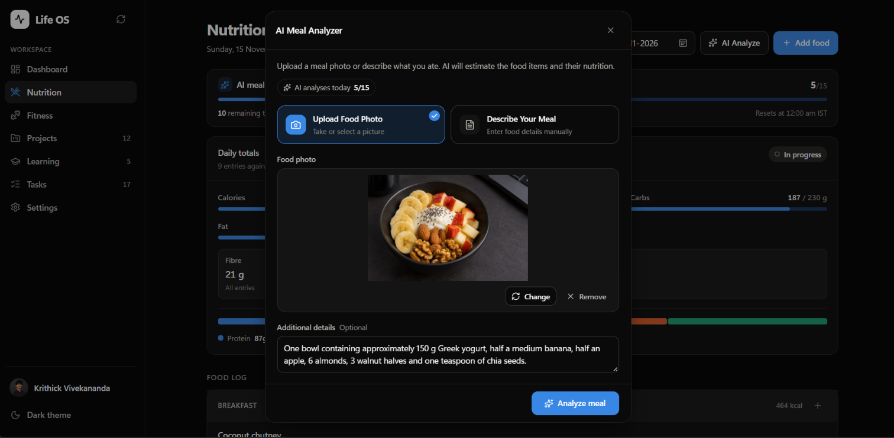
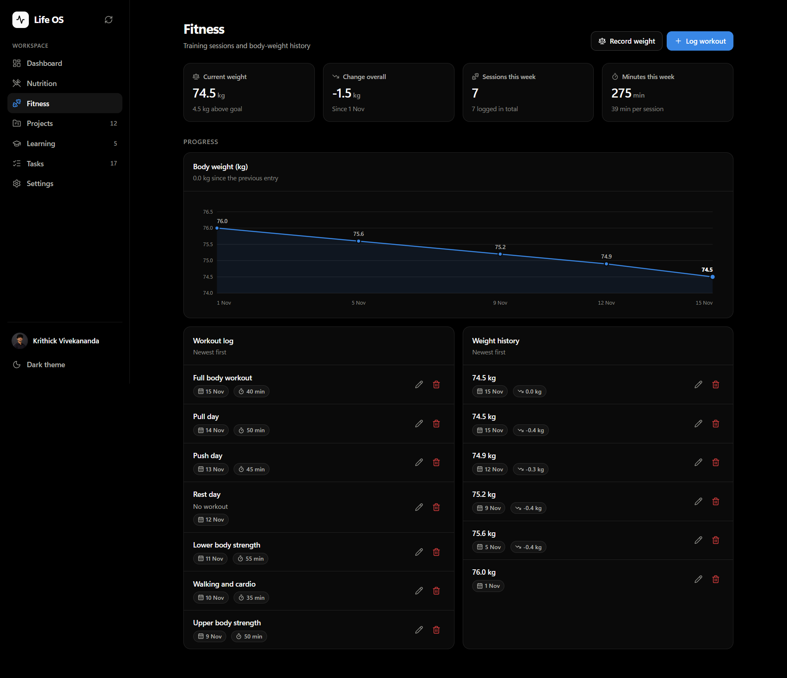
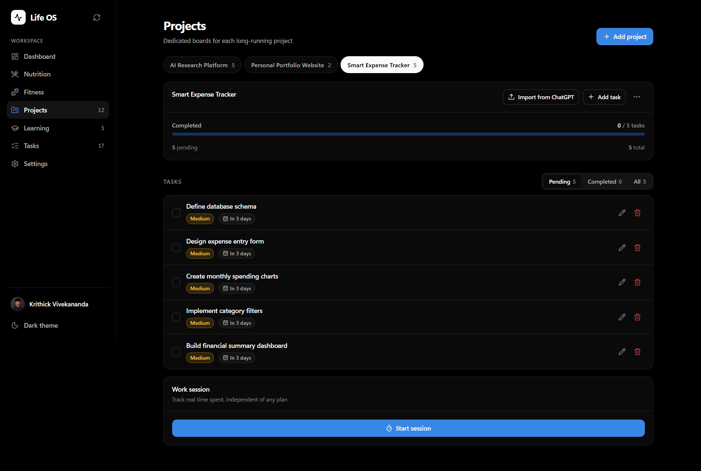
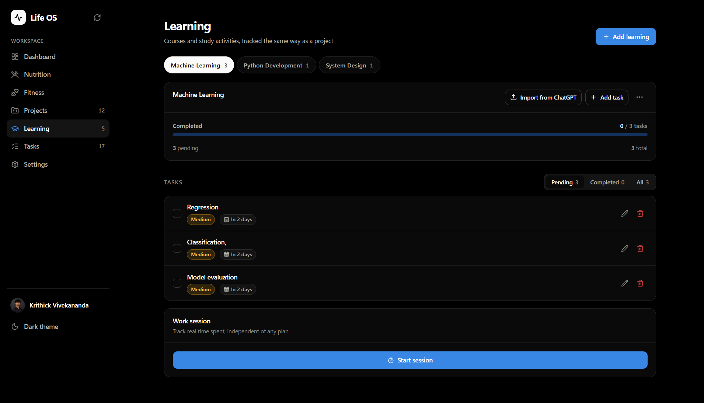
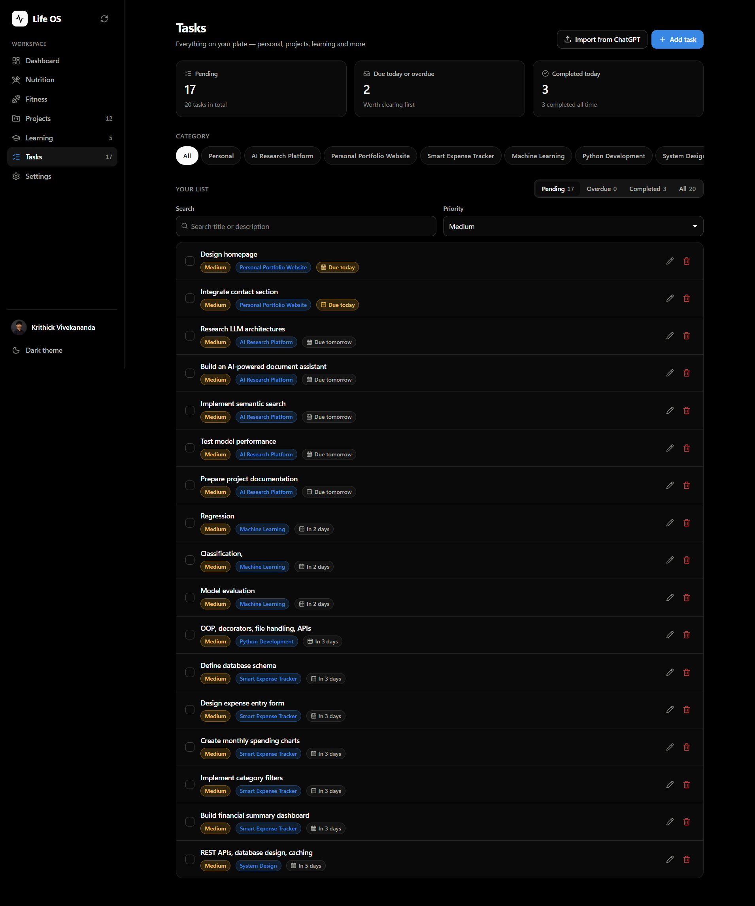
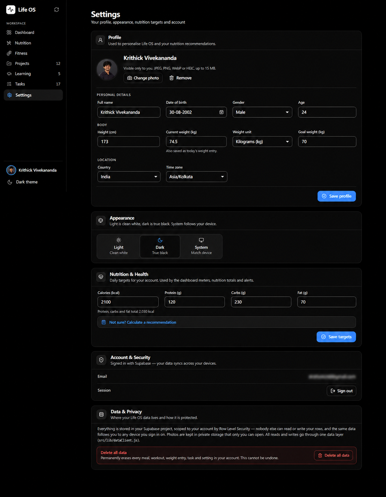

# LifeOS | Personal Life Management Platform

**One place to manage your health, productivity, projects and learning.**

LifeOS is a personal life-management platform designed to bring everyday activities into one unified workspace. It combines nutrition tracking, fitness monitoring, task management, project organization and learning management, with AI-assisted meal analysis using food photographs or text descriptions.

**Live Application:** [LifeOS](https://life-os-orcin-pi.vercel.app/)

---

## Overview

Managing personal health, daily responsibilities and long-term goals across multiple applications can become fragmented.

LifeOS addresses this by bringing these activities together in a single application with a unified dashboard, account-based data storage and a consistent tracking experience.

## Features

### 1. Dashboard
- Unified overview of personal activities.
- Task completion statistics and daily priorities.
- Upcoming tasks and deadlines.
- Project and learning progress.
- Nutrition and fitness summaries.
- Work-session analytics.

### 2. AI-Powered Nutrition Tracking
- Analyse food photographs using AI.
- Describe meals using natural language.
- Identify individual food items and estimate their nutritional values.
- Track calories, protein, carbohydrates and fats.
- Monitor fibre and sodium intake.
- Edit AI-generated estimates before saving.
- Food Gallery with meal photographs and history.
- Daily nutrition statistics and accountability tracking.

AI-generated nutritional values are estimates and should be reviewed before saving.

### AI Meal Analyzer

The analyzer supports two input methods:
- Upload a photograph of your meal.
- Describe your meal using text.

It returns an itemized food breakdown and estimated nutritional information.

### 3. Fitness Tracking
- Record body-weight entries.
- Visualize weight changes over time.
- Log workouts and training sessions.
- Monitor weekly workout activity.
- Track progress towards a goal weight.

### 4. Project Management
- Create dedicated boards for individual projects.
- Organize project-specific tasks.
- Track completed and pending activities.
- Monitor project progress.
- Import tasks from ChatGPT.

### 5. Learning Management
- Organize courses and learning activities.
- Create separate learning boards.
- Track study tasks and completion.
- Record focused study sessions.
- Monitor learning progress.

### 6. Task Management
- Centralized task management across different categories.
- Set priorities and due dates.
- Filter tasks by category and status.
- Track pending, completed and overdue tasks.
- Import structured tasks from ChatGPT.

### 7. Profile and Settings
- Personal profile management.
- Customizable nutrition targets.
- Light, dark and system appearance modes.
- Account management and data controls.

---

## Technology Stack

| Area | Technologies |
|---|---|
| Frontend | React 19 |
| Build Tool | Vite 8 |
| Backend Services | Supabase |
| Database | PostgreSQL |
| Authentication | Supabase Auth, Google OAuth |
| File Storage | Supabase Storage |
| Server-side Logic | Supabase Edge Functions |
| AI Integration | OpenAI API |
| Charts and Icons | Recharts, Lucide React |
| Deployment | Vercel |

## Architecture Overview

LifeOS follows a frontend and backend-services architecture.

- **Frontend:** React-based application with reusable components and centralized application state.
- **Authentication:** Supabase Auth provides account authentication.
- **Database:** PostgreSQL stores application data with Row Level Security policies.
- **Storage:** Supabase Storage manages private meal photographs.
- **AI Processing:** A Supabase Edge Function handles meal-analysis requests and communicates with the OpenAI API.
- **Deployment:** The frontend is deployed through Vercel.

## Data and Privacy

- User data is associated with authenticated accounts.
- Database access is protected using Row Level Security.
- Meal photographs are stored in private storage.
- AI requests are processed through a server-side Edge Function.
- API credentials are kept on the server side rather than exposed in frontend code.

## Current Scope and Limitations

LifeOS is an actively developed personal application.

- AI meal analysis requires a configured Supabase connection.
- Nutritional values generated by AI are estimates.
- Apple Health and wearable-device integrations are not currently implemented.
- AI-generated workout recommendations are not currently implemented.

## Project Links

- **Live Application:** [LifeOS](https://life-os-orcin-pi.vercel.app/)
- **Portfolio Repository:** [LifeOS-Portfolio](https://github.com/krithickvivek/LifeOS-Portfolio)

---

*LifeOS is a personal project focused on bringing health tracking, productivity and learning management into one unified application.*